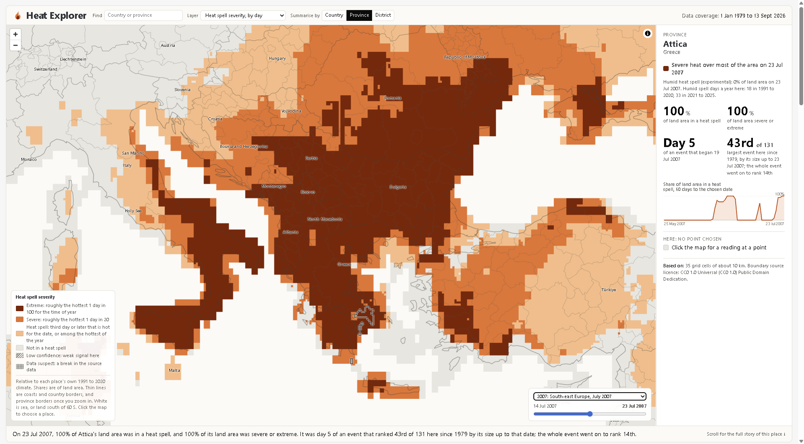

# Heat Explorer

An interactive dashboard of heat spells over the world's land, day by day from
1 January 1979 to 29 October 2026, for every country, province and district.

## What the dashboard can tell you

For any country, province or district, and for any point on the map:

- **How much of the area is in a heat spell on a given date**, and how much of
  it is severe or extreme.
- **How long the current event has lasted**, and how it ranks against every
  event there since 1979.
- **Whether the heat is by day, by night, or both.**
- **Where inside the area the heat sat**, week by week.
- **What past heat waves looked like**: 61 documented events since 1995 can be
  opened from the Period menu.
- **Whether heat spell days are becoming more common** over the decades.
- **How far to trust the numbers** in that place.

It describes the record up to 29 October 2026. It is not a forecast and not a
warning service.



<!-- Figure: a screenshot of the top of the page (controls, map and place summary), saved as docs/img/dashboard.png -->

## What it can do

The dashboard is live at <https://bennyistanto.github.io/heat-explorer>. You can build it locally too (see "Run it").

**Choose what the map shows.**

| Layer | Each grid cell is coloured by |
|---|---|
| Heat spell severity, by day | the class that day: heat spell, severe or extreme |
| Severe days, or heat spell days, in a year | the count for the chosen year, 1979 to 2025 |
| Severe days, or heat spell days, in a month | the count for the chosen month, January 1979 to September 2026 |
| Season status, last 12 weeks | whether heat there is new, back again, continuing or over |
| Trend in heat spell days | the change per decade, where it passes a significance test |
| Humid heat spell (experimental) | whether heat and humidity together were unusual |

**Choose when.** The daily map covers the last 365 days of data and the days
around each of the 61 past events. The Period menu switches between them and
moves the map to the event.

**Choose where.** Click the map, or type a country or province in the Find box.
"Summarise by" switches between country, province and district.

**Read the story under the map.** For the chosen place: the share of land in
each class over the last 90 days, hot days against hot nights, every event on
record, every day since 1979 in one picture, small maps week by week, the
long-term trend, and a plain statement of how far to trust it.

## What "heat spell" means here

Three or more days in a row when the three-day average of daily mean
temperature is in the top tenth for that date and above the place's median for
the year, or in the top twentieth of the whole year. A spell day is **severe**
when it is among roughly the hottest 1 day in 20 for that time of year in 1991
to 2020, and **extreme** when among the hottest 1 in 100.

This is the project's own definition. It is frozen as detector version 1.0 in
[docs/detector-v1-frozen.md](docs/detector-v1-frozen.md), and
[docs/heat-indices-compared.md](docs/heat-indices-compared.md) sets it beside
the standard indices (WSDI, the Excess Heat Factor).

## Read this before trusting a number

- Everything is relative to each place's own 1991 to 2020 climate. It is not a
  measure of heat stress on people.
- Near the equator, where temperature changes little from day to day, the
  source data follows observed hot days less well. Those areas are hatched as
  low confidence.
- 1,301 grid cells have a known break in the source data. They are marked, and
  kept in every number.
- Shares are of land area, not of people. A small district rests on few grid
  cells.
- The humid heat layer is experimental.
- The newest day shown is two days behind the newest data.

[docs/agera5-vs-stations.md](docs/agera5-vs-stations.md) gives the evidence
behind the confidence classes and the data breaks.

## Run it

The AgERA5 files and the boundary files are not in this repository. Their
paths are set at the top of each script in `pipeline/`. Python is run through
`tools/py.sh`. Then, in this order:

```
bash tools/py.sh pipeline/run_global.py
bash tools/py.sh pipeline/check_global.py
bash tools/py.sh pipeline/admin_lookup.py
bash tools/py.sh pipeline/admin_series.py
bash tools/py.sh pipeline/check_admin.py
bash tools/py.sh pipeline/run_daynight.py
bash tools/py.sh pipeline/run_humid.py
bash tools/py.sh pipeline/web_outlines.py
bash tools/py.sh pipeline/web_lines.py
bash tools/py.sh pipeline/web_products.py
bash tools/py.sh pipeline/check_web.py
npm install
npm run build
npm run serve
```

and open http://localhost:3312. The steps that read the whole record take
hours.

`npm run deploy` publishes the built site to the `gh-pages` branch; see the
notes at the top of `tools/deploy.ps1`. `npm run deploy:check` does everything
except the push.

Some script headers cite `references/indicators.md` and similar files. Those
are working notes kept outside this repository; the definitions that matter are
in `docs/`.

## Built with

Python for the pipeline and [Observable Framework](https://observablehq.com/framework/)
for the page, with MapLibre GL for the map.

## Data

- Temperature and humidity: AgERA5, Copernicus Climate Change Service,
  [doi:10.24381/cds.6c68c9bb](https://doi.org/10.24381/cds.6c68c9bb).
- Boundaries: FieldMaps Global Edge-matched Subnational Boundaries (provinces
  and districts) and OpenStreetMap contributors (countries), under the Open
  Database License 1.0. Borders and names are shown as the sources give them
  and do not express any view on the status of a territory or its borders.

## Author

Developed by [Benny Istanto](https://benny.istan.to) as a casual weekend
project.

## License

See [LICENSE](LICENSE).
